<p align="center">
  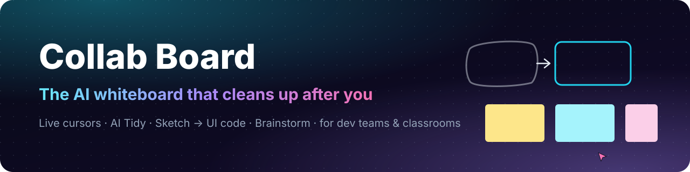
</p>

<p align="center">
  <a href="https://ai-collab-whiteboard.vercel.app"></a>
  <br/><a href="https://ai-collab-whiteboard.vercel.app">ai-collab-whiteboard.vercel.app</a>
</p>

<p align="center">
  <a href="https://nextjs.org"></a>
  <a href="https://www.typescriptlang.org"></a>
  <a href="https://tailwindcss.com"></a>
  <a href="https://yjs.dev"></a>
  <a href="https://www.anthropic.com/claude"></a>
  
  
  <a href="LICENSE"></a>
</p>

**Collab Board** is a real-time multiplayer whiteboard for **dev teams and classrooms**. Share a link and everyone in the room sees live cursors and presence. You can draw with a pen, shapes, arrows, sticky notes and text. Three AI features built on **Claude** do the cleanup:

- **AI Tidy** turns rough sketches into a clean diagram.
- **Sketch → UI code** turns a wireframe into HTML + Tailwind, using Claude vision.
- **Brainstorm** turns a prompt into colour-grouped sticky notes.

It runs fully **without an API key** in a built-in demo mode, so you can clone it and try it in a minute.

<p align="center">
  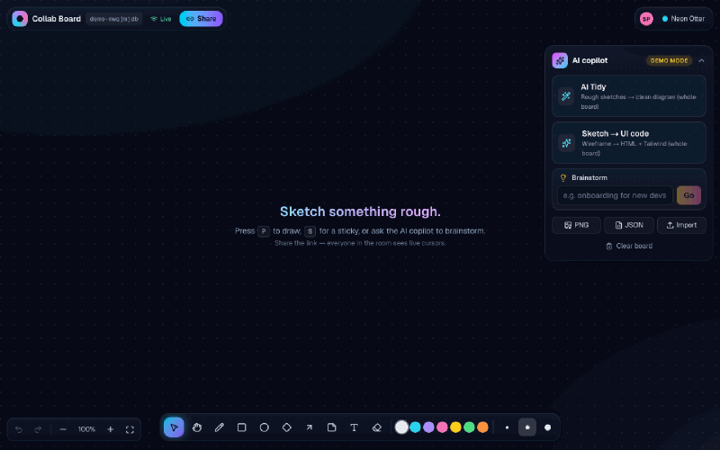
</p>

## ✨ Features

| | |
|---|---|
| 🖱️ **Live cursors & presence** | Everyone's cursor, name, colour and current selection, in real time (Yjs awareness). |
| 🔗 **Rooms via share link** | Every board is a room at `/board/<id>`. The **Share** button copies the link. |
| ✏️ **Drawing tools** | Pressure-smoothed pen ([perfect-freehand](https://github.com/steveruizok/perfect-freehand)), rectangle, ellipse, diamond, arrow, sticky note, text and eraser. |
| 🧲 **Select / move / resize** | Click, shift-click, marquee select, drag to move, resize handle, duplicate (⌘D), delete. |
| ↩️ **Per-user undo/redo** | `Y.UndoManager` only undoes *your* changes. It never removes a collaborator's work. Each AI action is one undo step. |
| 🪄 **AI Tidy** | Classifies each freehand stroke (rect / ellipse / diamond / line / arrow), snaps to a 20 px grid, aligns rows and columns, puts loose text into shapes as labels, and connects arrows to shape edges. With a key, Claude also refines the layout and labels. |
| 🧩 **Sketch → UI code** | Renders the selection to PNG and sends it to **Claude vision**, which returns HTML + Tailwind. You get a live sandboxed preview and a copy button. |
| 💡 **Brainstorm** | Prompt → 8 ideas in 3–4 themes, laid out as coloured sticky-note columns below your existing content. |
| 📤 **Export / import** | 2× PNG export and a lossless JSON snapshot that you can re-import or commit to git. |
| 📴 **Resilient sync** | A small self-hosted WebSocket server (y-websocket protocol), a **BroadcastChannel** fallback between tabs when the server is down, and IndexedDB offline persistence. |
| 🌌 **Futuristic UI** | Dark neon glassmorphism, smooth micro-animations, responsive down to phones, `prefers-reduced-motion` aware. |

## 📸 Screenshots

| Landing | Pricing (Free vs Team) |
|---|---|
| 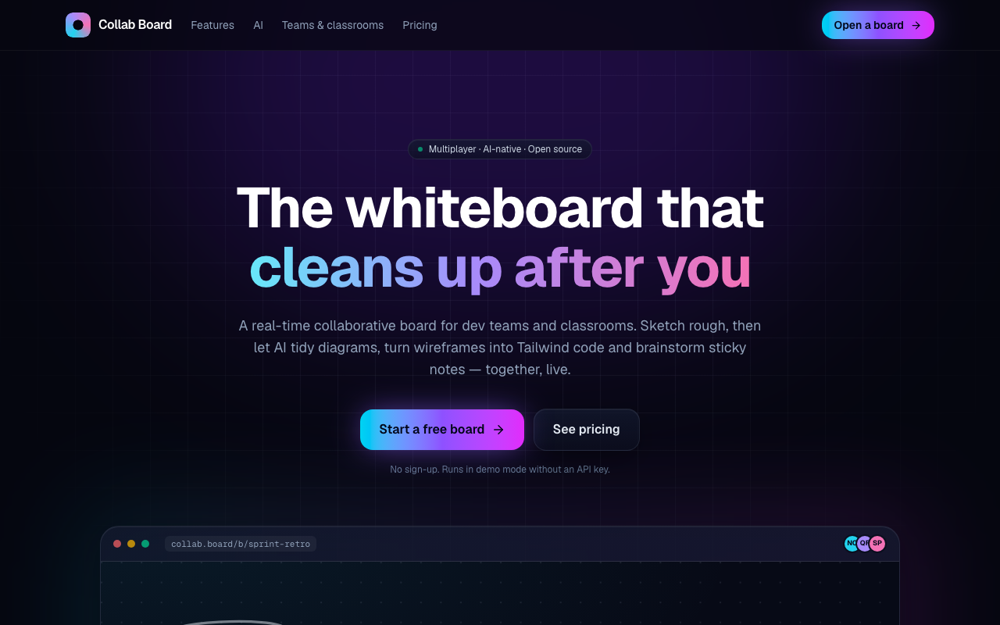 | 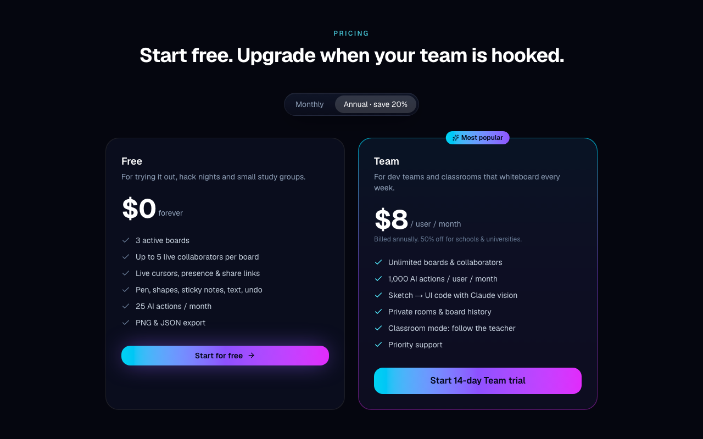 |
| **Rough sketch…** | **…after AI Tidy** |
| 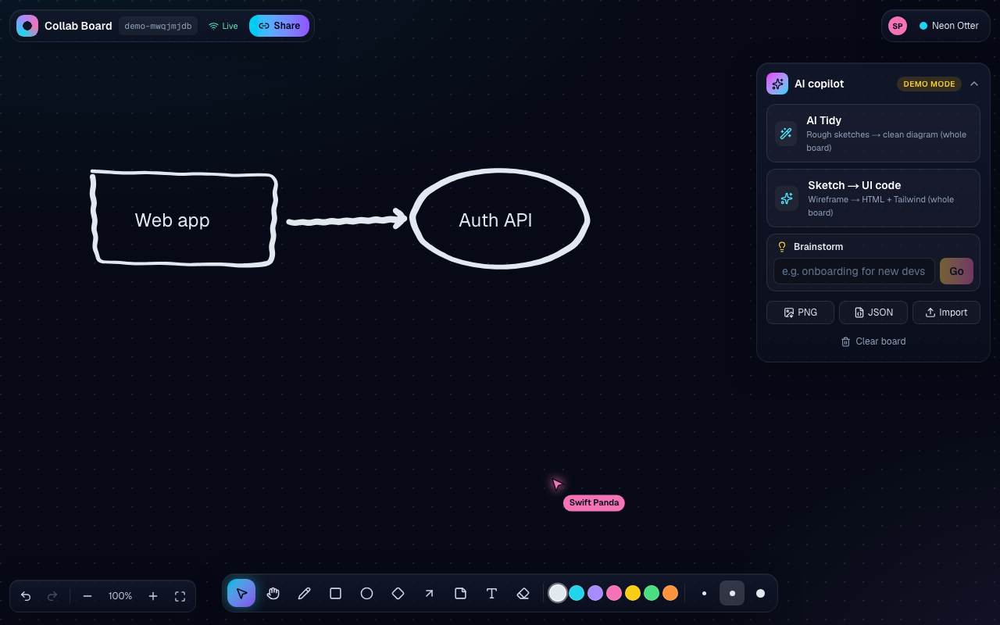 | 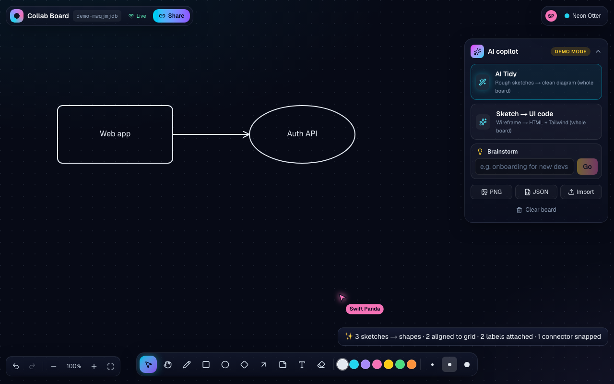 |
| **Brainstorm → sticky notes** | **Sketch → UI code** |
| 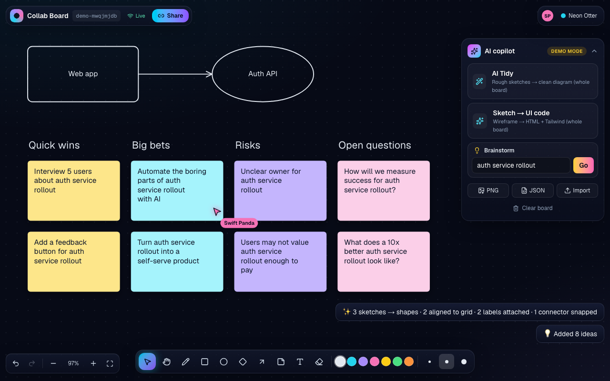 | 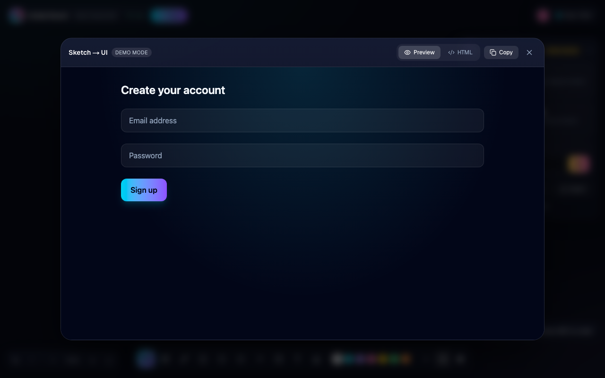 |
| **Second user's view (live cursor + presence)** | **AI features on the landing page** |
| 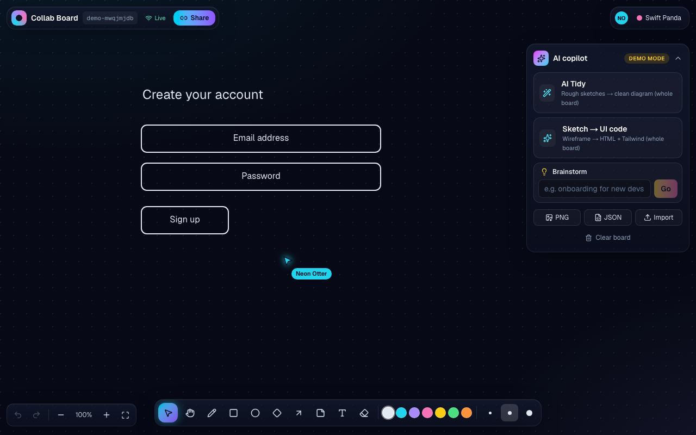 | 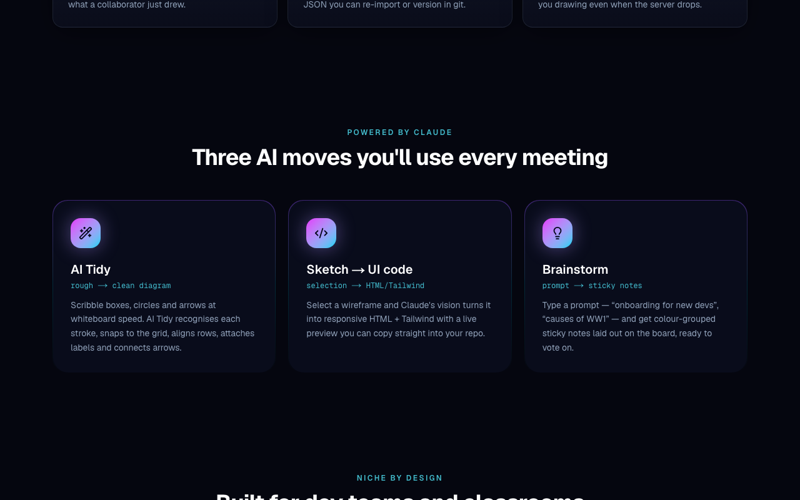 |

> All images are real Playwright captures of the app in demo mode (`npm run docs:capture`).

## 🏗️ Architecture

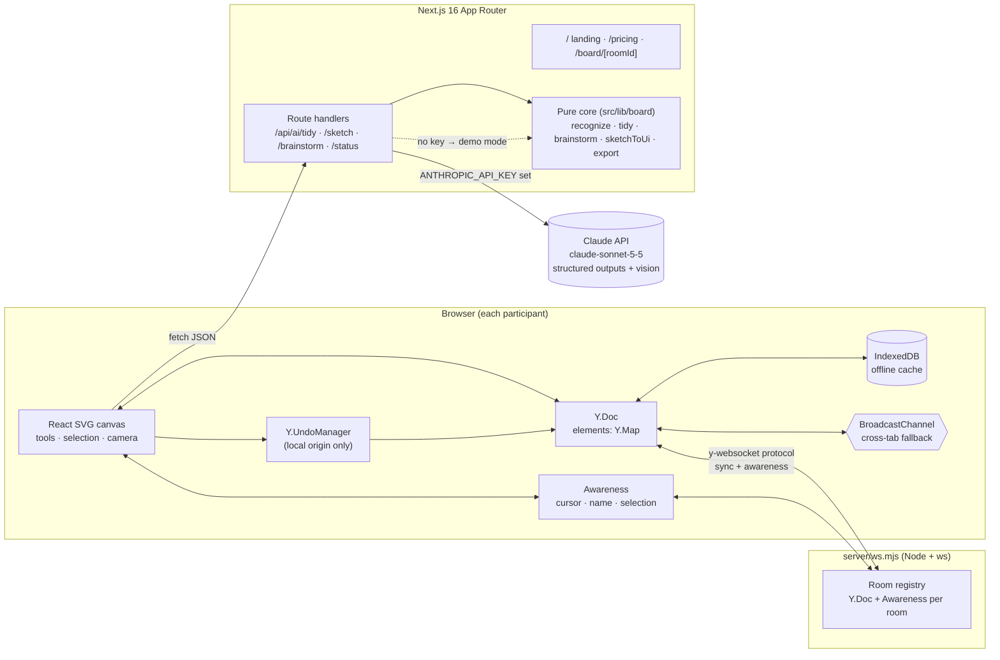

**How the AI routes work**

1. Each route validates and cleans its input. Element counts, string lengths and numbers are clamped (`sanitizeElement`).
2. The deterministic core always runs first. AI Tidy *always* uses the local shape recogniser, so demo mode and live mode share the same "rough → clean" behaviour.
3. With `ANTHROPIC_API_KEY` set, the route calls `claude-sonnet-5-5` with **structured outputs** (JSON schema) and server-side refusal fallbacks. Sketch → UI also sends the PNG for **vision**.
4. If Claude fails (bad key, rate limit, refusal), the user gets the demo result plus a warning toast. The app never breaks.
5. Model HTML is cleaned (no `<script>`, no inline handlers) and shown in an `iframe sandbox="allow-scripts"` that cannot reach the parent page.

## 🧰 Tech stack

- **Next.js 16** (App Router, Cache Components, Route Handlers) + **React 19** + **TypeScript**
- **Tailwind CSS v4**, `lucide-react` icons, pure-CSS animations
- **Yjs** + **y-websocket** client + **y-protocols**, **y-indexeddb**, and a custom ~150-line Node WebSocket server
- **perfect-freehand** for ink rendering
- **@anthropic-ai/sdk** → Claude Sonnet 5.5 (structured outputs, vision, server-side fallbacks)
- **Vitest** (unit/route tests) and **Playwright** (e2e, multi-browser realtime tests, doc capture), **gifenc** for the demo GIF

## 🚀 Getting started

```bash
git clone https://github.com/BhargavKJani/ai-collab-whiteboard.git
cd ai-collab-whiteboard
npm install
cp .env.example .env.local   # optional: add ANTHROPIC_API_KEY for live Claude
npm run dev                  # Next.js on :3000 + realtime server on :1234
```

Open <http://localhost:3000>, click **Start a free board**, then open the same URL in a second browser (or send it to a friend on your network).

| Script | What it does |
|---|---|
| `npm run dev` | Next dev server + realtime WebSocket server (via `concurrently`) |
| `npm run build` / `npm start` | Production build, then serve web + realtime server |
| `npm run ws` | Only the realtime server (`WS_PORT`, default 1234) |
| `npm run lint` · `npm run typecheck` | ESLint · `tsc --noEmit` |
| `npm test` | Vitest unit + API route tests (38) |
| `npm run test:e2e` | Playwright e2e in demo mode (8). Needs `npm run build` first; run `npx playwright install chromium` once |
| `npm run docs:capture` | Recreates the screenshots and `docs/demo.gif` (app must be running on `:3417`) |

**Environment variables** (see [`.env.example`](.env.example)):

| Variable | Purpose |
|---|---|
| `ANTHROPIC_API_KEY` | Enables live Claude. When unset, the app runs in demo mode. |
| `AI_MODE=mock` | Forces demo mode even when a key is present (used by tests) |
| `NEXT_PUBLIC_WS_URL` | Realtime server URL when it isn't `ws://<host>:1234` |
| `WS_PORT`, `WS_HOST` | Bind settings for `server/ws.mjs` |

### Keyboard shortcuts

`V` select · `H` pan (or hold `Space`) · `P` pen · `R` rect · `O` ellipse · `D` diamond · `A` arrow · `S` sticky · `T` text · `E` eraser · `Enter` edit text · `⌘/Ctrl+Z` undo · `⇧⌘Z` / `⌘Y` redo · `⌘D` duplicate · `⌘A` select all · `Delete` remove · `⌘ + scroll` zoom · double-click to add or edit text.

## ✅ Testing

- **Unit (Vitest, 38 tests):** shape recognition (rect / ellipse / diamond / line / arrow / scribble), the tidy pipeline (grid snap, row alignment, label attach, connector snapping, no input mutation), geometry (camera round-trip, zoom anchor, hit-testing, resize), brainstorm generation and layout, SVG/JSON export and import validation, Sketch → UI mapping and HTML cleaning, room IDs, and the API route handlers in demo mode.
- **E2E (Playwright, 8 tests):** landing → pricing toggle → new board, every drawing tool with select/move/undo/redo/delete, AI Tidy on real mouse-drawn strokes (and undo as one step), Brainstorm, Sketch → UI preview inside the sandboxed iframe, PNG/JSON export and re-import, **two separate browsers syncing through the WebSocket server** (shapes, cursors, presence, per-user undo), and **BroadcastChannel fallback** when the server can't be reached.

## 💰 Business model

The landing page includes a built-in **Free vs Team** pricing page (`/pricing`). The plan limits shown there are not enforced yet (see roadmap).

| | **Free** | **Team** — $8/user/mo annual ($10 monthly) |
|---|---|---|
| Boards | 3 active | Unlimited |
| Live collaborators | 5 per board | Unlimited |
| AI actions | 25 / month | 1,000 / user / month |
| Sketch → UI (Claude vision) | Demo generator | ✅ |
| Private rooms, history, classroom "follow the teacher" | – | ✅ |

- **Wedge:** generic whiteboards don't speak "dev". Sketch → UI code and diagram tidying are things engineers will pay for, and teachers get one-link classes with no student accounts.
- **Unit economics:** an AI action costs roughly $0.002–0.02 with Claude Sonnet 5.5, so 1,000 actions stay well under the seat price. Metered overage packs and an **Education** tier (50% off) cover heavy users.
- **Expansion:** per-seat Team plan, then an Enterprise tier (SSO/SAML, data residency, self-hosted realtime, audit log). Self-hosting stays MIT-licensed as the community and SEO funnel.
- **Distribution:** shareable board links act as viral loops (each guest sees "Made with Collab Board"), plus GitHub/Slack/LMS integrations and templates (retro, system design, lesson warm-ups).

## 🗺️ Roadmap

- [ ] Auth (GitHub / Google / school SSO) and private rooms
- [ ] Stripe billing and per-plan AI quotas (the limits shown on `/pricing`)
- [ ] Durable room storage (Postgres or S3 snapshots) and version history
- [ ] Classroom mode: follow the presenter, lock the canvas, timers
- [ ] More AI: "explain this diagram", diagram → Mermaid/PlantUML, retro clustering and voting
- [ ] Sketch → React/JSX export and "open in StackBlitz"
- [ ] Connectors that stay attached when shapes move; frames and templates
- [ ] Mobile pinch-zoom and Apple Pencil pressure
- [ ] One-click deploy (Vercel + Fly.io realtime) and a CI workflow

## 📄 License

[MIT](LICENSE) © 2026 Bhargav Jani
